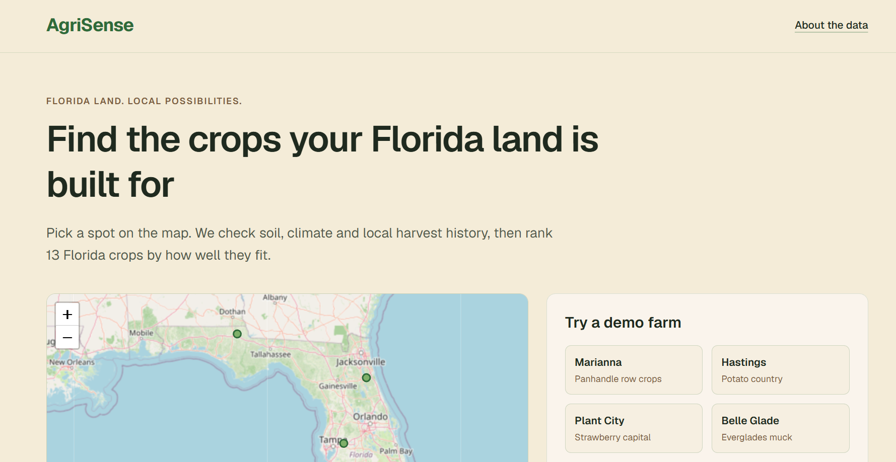
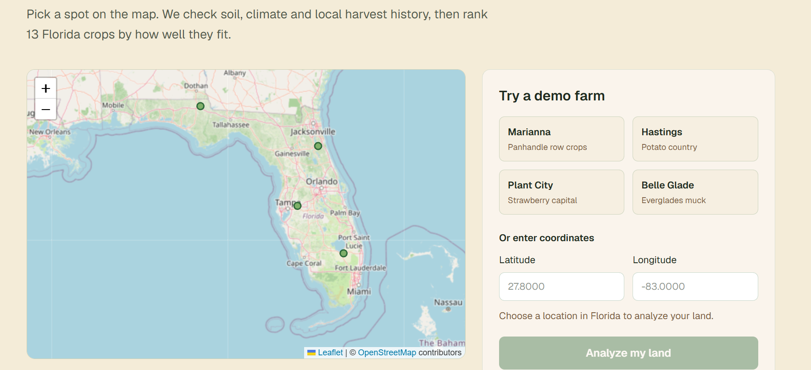
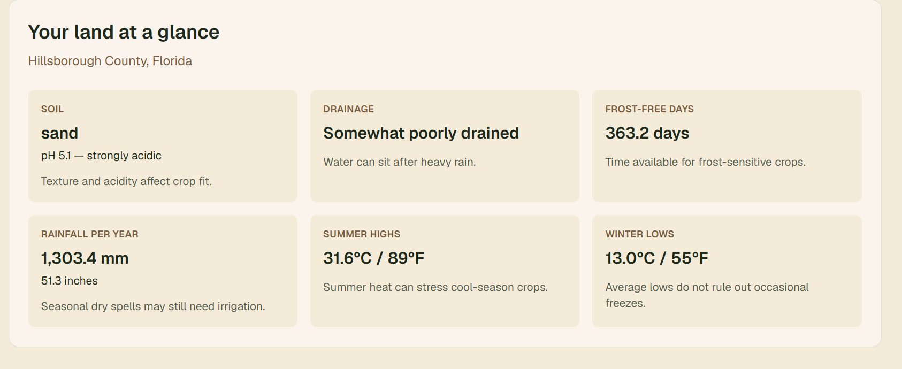
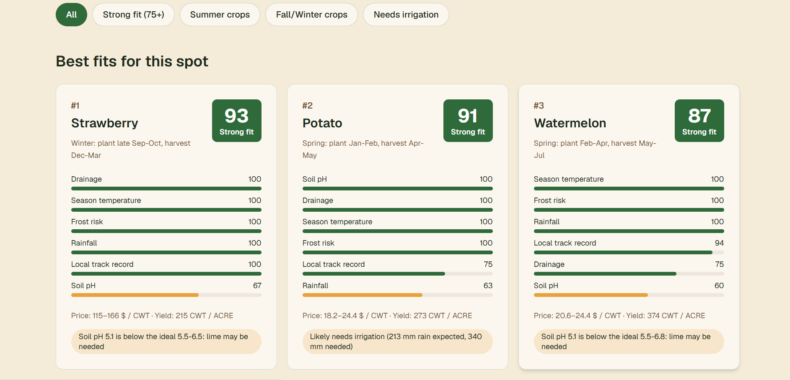
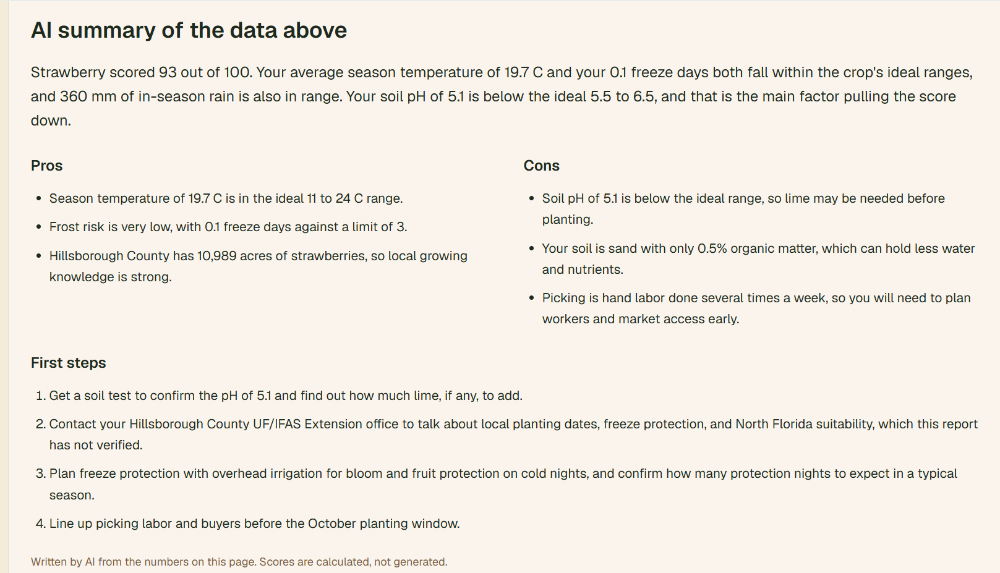
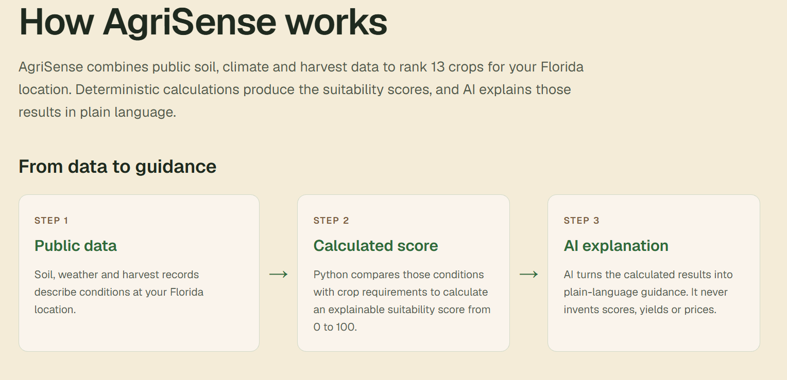
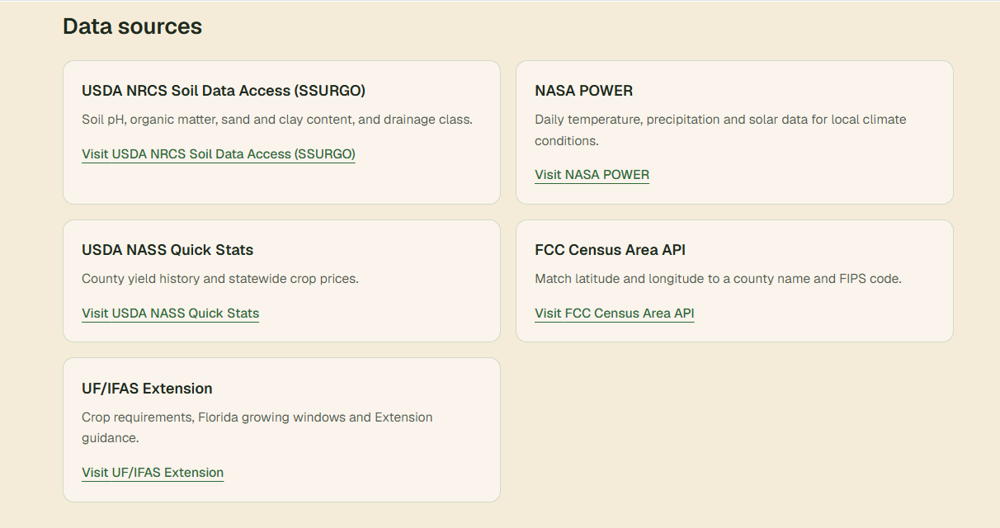
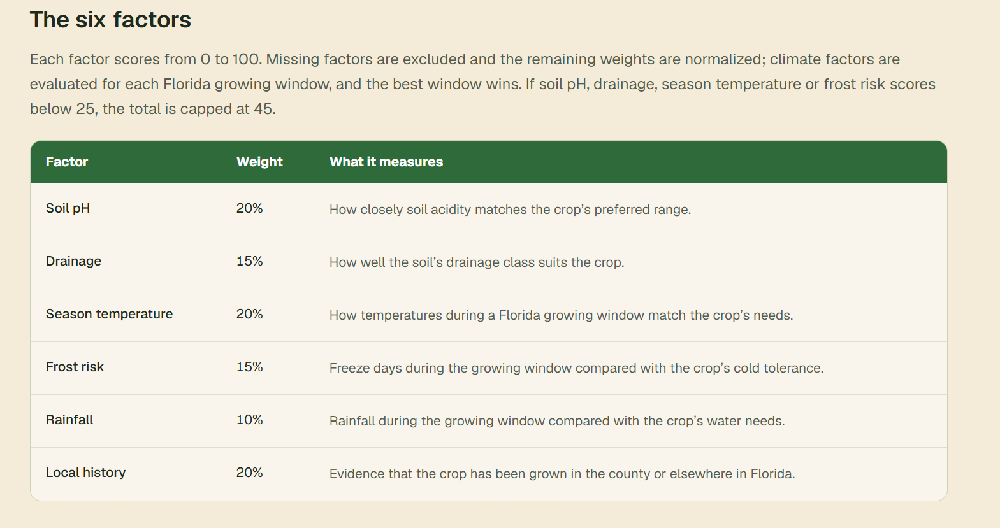

# AgriSense



[Try the live app](https://agrisense-ai-cyan.vercel.app)

AgriSense helps small and mid-scale Florida farmers decide what to plant by ranking 13 crops for a selected location. Each crop report includes an explainable suitability score, local yield and price history, growing guidance, and UF/IFAS Extension links.

## Judge summary

AgriSense turns a Florida map point into a ranked, explainable crop shortlist by combining public soil, climate, county-history, and price data with a deterministic scoring engine. The language model writes a bounded explanation after the score is calculated; it is not the source of the score.

The difficult-to-fake work is the end-to-end data path: provider-specific parsing and caches, Florida growing-window calculations, freeze weighting, muck-soil rules, county/state fallbacks, source provenance, and degraded responses when providers fail. The repository includes mocked provider tests, contract checks, deterministic demo fixtures, and a backend judging smoke test.

The scores are trustworthy as reproducible suitability indices, not as probabilities or guarantees: the formulas, weights, crop requirements, and missing-data rules are inspectable in [the methodology](docs/methodology.md), and responses expose warnings, source status, available-factor count, and confidence. They have not been validated against farm outcomes.

For the strongest live demo, show Plant City first, inspect strawberry's factors and report, then switch to Belle Glade and show how muck-soil rules change the conditions and ranking. Finish by showing provenance/confidence and the local fallback behavior, rather than claiming that a saved demo response is a fresh provider fetch.

Questions a skeptical judge should ask include how missing data changes a score, whether rankings are empirically validated, how fresh county records are, what happens when a provider or AI service fails, and whether the deployed API has been load-tested. The code supports the missing-data, provider-failure, provenance, and AI-fallback answers; it does not support claims of agronomic validation, comprehensive profit prediction, production uptime, or load-test capacity.

## Features

- Pick a Florida location on the map or enter latitude and longitude.
- Compare 13 crops ranked by deterministic, explainable suitability scores.
- Inspect six factors and the best Florida growing window for each crop.
- Review regional yield and price history, missing-data warnings, and UF/IFAS links.
- Read a plain-language AI report grounded in the calculated crop data, with a local fallback when AI is unavailable.

## How it works

USDA SSURGO soil data, NASA POWER climate history, and USDA NASS harvest and price records feed a Python scoring engine. It compares crop requirements across Florida growing windows, ranks the crops, and supplies the results to a server-side AI report generator. The AI does not calculate the scores.

Read the [methodology](docs/methodology.md) for factor weights, missing-data handling, and limitations. The four demo choices are example growing locations, not verified individual farms.

## Screenshot gallery

### Florida map and location controls



### Plant City results





### Strawberry report



### About AgriSense







Screenshots capture example responses; scores and reports can change as data changes. The strawberry screenshot shows the report section; its crop-detail factor chart is not pictured.

For a walkthrough, see the [75-second demo video script](docs/demo-video-script.md).

## Team

- Person A (backend): [Name]
- Person B (frontend): [Name]

## Run the backend

Needs Python 3.11 or newer. Get a free NASS Quick Stats key at
https://quickstats.nass.usda.gov/api.

macOS / Linux:

```bash
cd backend
python3 -m venv .venv
source .venv/bin/activate
pip install -r requirements.txt
cp .env.example .env
# edit .env and set NASS_API_KEY=your_key
uvicorn app.main:app --reload --port 8000
```

Windows (PowerShell):

```powershell
cd backend
python -m venv .venv
.venv\Scripts\Activate.ps1
pip install -r requirements.txt
Copy-Item .env.example .env
# edit .env and set NASS_API_KEY=your_key
uvicorn app.main:app --reload --port 8000
```

Check http://localhost:8000/api/health returns `{"status":"ok"}`, and run the
tests with `pytest`. Set `DEMO_MODE=true` in `.env` for a live demo: if the data
sources take over 6 s or fail, a point within 25 km of a demo farm gets that
farm's saved response (backend/data/demo) and other points get a quick 503.
More detail: [backend/README.md](backend/README.md).

For a running API, run the backend-only judge smoke test. It checks health, all
four demo recommendations, crop details, validation errors, response time,
crop count, score ordering/ranges, and non-finite numbers:

```bash
cd backend
python -m scripts.smoke_test http://localhost:8000
```

The URL may instead be supplied without a command-line argument through
`SMOKE_API_URL` or `RENDER_API_URL`. The command prints each check and exits
with status 1 if any check fails.

## Run the frontend

```bash
cd frontend
npm install
cp .env.local.example .env.local
npm run dev
```

Open http://localhost:3000. The example environment points to the live backend
at http://localhost:8000 and sets `NEXT_PUBLIC_USE_MOCKS=false`, so the browser
uses the API described above. Set it to `true` only when intentionally running
the frontend without a backend.
Open http://localhost:3000. The example environment points to the backend at
http://localhost:8000 with mock mode disabled. Start the backend before
using the frontend; set `NEXT_PUBLIC_USE_MOCKS=true` only for an offline UI demo.
Keep `ANTHROPIC_API_KEY` in `.env.local` and use it only on the server.

To check the frontend:

```bash
npm run lint
npm run build
```

## First-time setup

Set your own Git identity to match your GitHub account, then enable the repository hooks:

```bash
git config user.name "Your Name"
git config user.email "your-email@example.com"
git config core.hooksPath .githooks
```
Vercel Links:

  Inspect         https://vercel.com/rich5369/agrisense-ai/B2T3nyRfFb2vzo9wmnYeFRyo9d7G
  Production      https://agrisense-t2dq1ryjw-rich5369.vercel.ap
  Production      https://agrisense-t2dq1ryjw-rich5369.vercel.app
▲ Aliased         https://agrisense-ai-cyan.vercel.app
